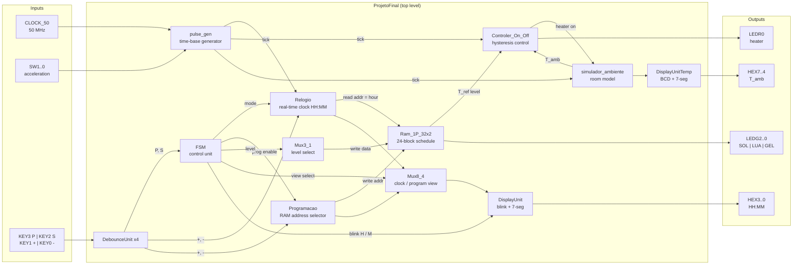
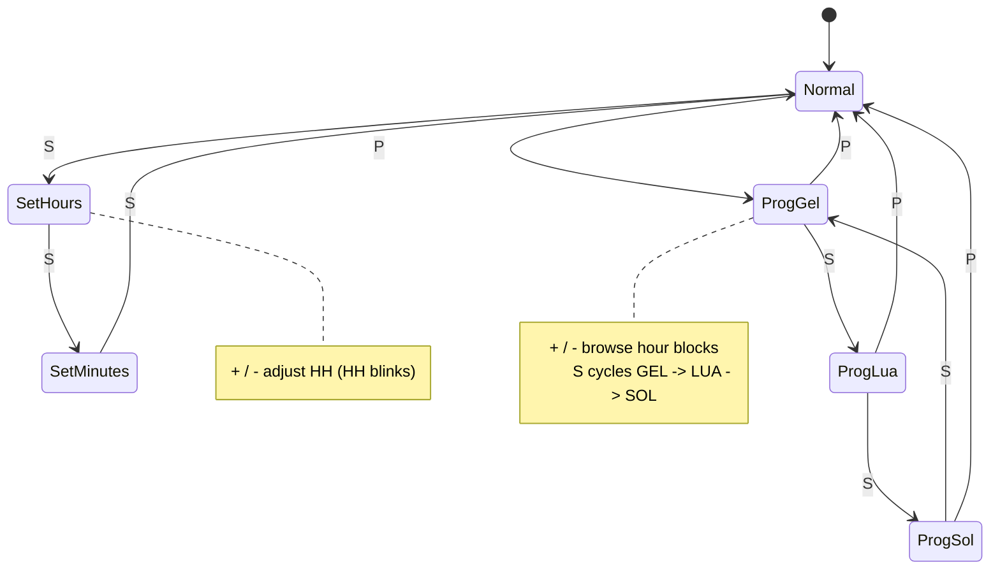
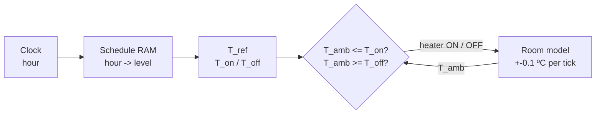

# FPGA Programmable Thermostat Controller

A programmable thermostat for domestic radiators, written in **VHDL** for an **Intel/Altera Cyclone IV E FPGA** (Terasic DE2-115 board). It combines a real-time clock, a 24-slot daily heating schedule kept in on-chip RAM, an ON/OFF (bang-bang) controller with hysteresis and a simulated room, so the whole closed loop runs on the board.

---

## Features

- **Bang-bang control with hysteresis:** the heater turns on below `T_ON` and off above `T_OFF`, which avoids rapid on/off switching around the setpoint.
- **Three preset temperature levels:**

  | Level | Setpoint | ON below | OFF above | LED |
  |-------|----------|----------|-----------|-----|
  | ☀️ Comfort (SOL) | 20.0 ºC | 18.1 ºC | 21.9 ºC | `LEDG2` |
  | 🌙 Economy (LUA) | 16.0 ºC | 14.6 ºC | 17.4 ºC | `LEDG1` |
  | ❄️ Anti-freeze (GEL) | 4.0 ºC | 3.1 ºC | 4.9 ºC | `LEDG0` |

- **Programmable daily schedule:** 24 one-hour blocks stored in RAM. Each block can be changed at runtime from the push-buttons.
- **Real-time clock (HH:MM):** a separate *set* mode adjusts hours and minutes, and the digits being edited blink.
- **Time acceleration:** a switch-selectable speed-up (x1, x60, x600, x3600) for demos and testing.
- **Room simulator:** a 9-bit up/down counter that models the room temperature, with a resolution of 0.1 ºC and a range of 0-51.1 ºC.
- **Clean user input:** every button is debounced and produces a single pulse lasting one clock cycle.
- **Small footprint:** about 1.2k logic elements and 310 registers, around 1 % of the EP4CE115.

---

## Architecture

### Datapath



### Control unit (FSM)



### Control loop



---

## User interface

| Control | Function |
|---------|----------|
| `KEY3` (**P**) | Enter or leave **programming mode** |
| `KEY2` (**S**) | Clock set (Normal -> HH -> MM -> Normal). In programming mode, cycles the level of the selected block |
| `KEY1` (**+**) | Increment the hour, minute or schedule block |
| `KEY0` (**-**) | Decrement the hour, minute or schedule block |
| `SW1..0` | Time acceleration: `00` x1 | `01` x60 | `10` x600 | `11` x3600 |
| `HEX3..0` | Clock `HH:MM`, or the selected block `HH:00` in programming mode |
| `HEX7..4` | Room temperature (0.1 ºC resolution) |
| `LEDG2..0` | Active level: SOL / LUA / GEL |
| `LEDR0` | Heater state |

### Default schedule

| Hours | 00-05 | 05-07 | 07-18 | 18-20 | 20-24 |
|-------|-------|-------|-------|-------|-------|
| Level | ❄️ GEL | 🌙 LUA | ☀️ SOL | 🌙 LUA | ❄️ GEL |

---

## Module overview

| Module | Description |
|--------|-------------|
| `ProjetoFinal.vhd` | Top-level structural entity that wires the datapath to the board I/O |
| `FSM.vhd` | Control unit: Normal, Set (H/M) and Program (GEL/LUA/SOL) states |
| `pulse_gen.vhd` | Configurable time-base from the 50 MHz clock |
| `DebounceUnit.vhd` | Button debouncer that outputs a single-cycle pulse |
| `Relogio.vhd` | Real-time clock (`count60`, `count24`, `ClockController`, `NormalMod`, `RelogioControler`) |
| `Programacao.vhd` | Schedule block selector used as the RAM write address |
| `Ram_1P_32x2.vhd` | Schedule memory (24 x 2-bit words) with level LED decoding |
| `Mux3_1.vhd`, `Mux8_4.vhd` | Level selection and clock/program display multiplexing |
| `Controler_On_Off.vhd` | Hysteresis comparator for each temperature level |
| `simulador_ambiente.vhd` | Up/down counter that models the room temperature |
| `DisplayUnit.vhd`, `DisplayUnitTemp.vhd` | BCD conversion, blinking and 7-segment decoding |
| `Bin2BCD`, `BinMinBCD`, `Bin9Bits2BCD`, `Bin7SegDecoderEn` | Conversion and decoding helpers |
| `FSM_Tb.vhd`, `Ram_1P_32x2_Tb.vhd` | Testbenches |
| `Diagrama_Projeto_Final.bdf` | Block diagram (Quartus schematic) |

---

## Repository structure

```
.
|-- README.md
|-- project-files/
    |-- ProjetoFinal.qpf / .qsf     # Quartus project and settings
    |-- master.qsf                  # DE2-115 pin assignments
    |-- ProjetoFinal.vhd            # Top level
    |-- *.vhd                       # RTL modules
    |-- *_Tb.vhd                    # Testbenches
    |-- *.bsf / *.bdf               # Quartus symbols and block diagram
    |-- simulation/                 # ModelSim / Quartus waveform setup
```

---

## Getting started

### Requirements

- Intel **Quartus Prime** (Lite edition is enough) with Cyclone IV E device support
- **ModelSim** / Questa (Intel FPGA edition) for simulation
- Terasic **DE2-115** board (`EP4CE115F29C7`)

### Build and program

1. Open `project-files/ProjetoFinal.qpf` in Quartus.
2. Run **Processing -> Start Compilation**.
3. Open **Tools -> Programmer**, select `output_files/ProjetoFinal.sof` and program the board over USB-Blaster.

### Simulate

1. In Quartus, set `FSM_Tb` or `Ram_1P_32x2_Tb` as the simulation testbench (**Assignments -> Settings -> Simulation**).
2. Run **Tools -> Run Simulation Tool -> RTL Simulation**.

---

## Tech stack

`VHDL` | `Intel Quartus Prime` | `ModelSim` | `Cyclone IV E` | `Terasic DE2-115`
